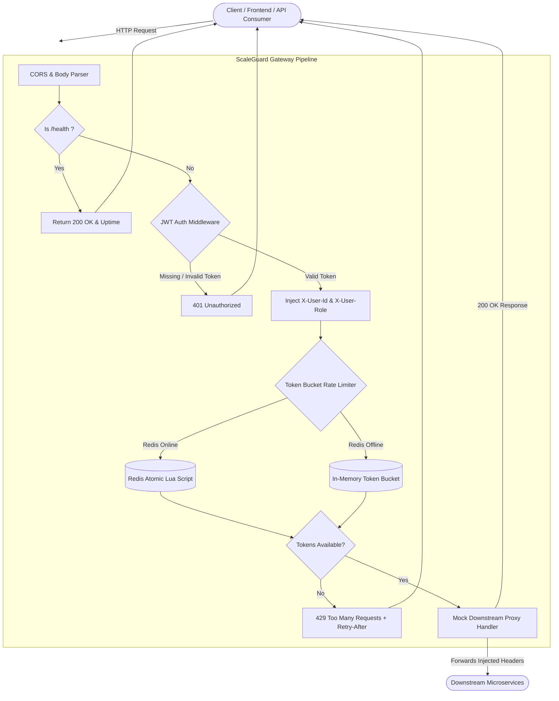

# ScaleGuard API Gateway

> **High-Performance, Resilient API Gateway with Atomic Distributed Token-Bucket Rate Limiting & JWT Identity Injection**

ScaleGuard is an enterprise-ready API Gateway built with **Node.js**, **Express 5**, and **Redis**. It provides zero-compromise edge protection featuring distributed rate limiting via atomic Redis Lua scripting, seamless in-memory fallback during Redis outages, cryptographically verified JWT authentication, and automatic downstream claim header injection.

---

## Architecture & System Flow



---

## Tech Stack

| Technology | Purpose |
| :--- | :--- |
| **Node.js (v20+)** | High-throughput asynchronous runtime |
| **Express 5** | Core HTTP server and middleware orchestration with path-to-regexp v8 |
| **ioredis** | High-performance Redis client with connection pooling and custom Lua scripting |
| **Redis 7** | Distributed in-memory data store for token bucket synchronization |
| **JSON Web Tokens (jsonwebtoken)** | Cryptographic signature verification and claim propagation |
| **Docker & Docker Compose** | Multi-container reproducible deployment |

---

## Key Engineering Highlights

### 1. Atomic Distributed Token Bucket (Redis Lua)
- Rate limiting is implemented using the **Token Bucket** algorithm evaluated lazily.
- Handled entirely within a custom **Redis Lua script** executed atomically on the Redis engine.
- Prevents race conditions and lost token updates across multiple gateway replicas without distributed locks or excessive network round-trips.
- Automatically calculates replenishments on-the-fly: `current_tokens = math.min(capacity, current_tokens + (elapsed_seconds * refill_rate))`.
- Sets dynamic expiration (`EXPIRE`) so dormant client keys are cleaned up automatically.

### 2. Zero-Downtime In-Memory Fallback
- If the Redis cluster is restarting, network-partitioned, or offline, ScaleGuard's `redisClient` catches connection errors gracefully with non-blocking reconnection backoffs.
- The `rateLimiter` transparently fails over to an **in-memory token bucket**, preserving rate limits and ensuring the gateway never crashes or drops traffic.

### 3. JWT Verification & Claim Header Injection
- Authenticates requests matching `/api/v1/service/*` using standard `Authorization: Bearer <token>` headers.
- Verifies HMAC signatures and token expiration (`exp`).
- Extracts verified user claims (`userId`, `role`) and injects them directly into request headers:
  - `X-User-Id`: Authenticated user identity
  - `X-User-Role`: Assigned authorization role
- Allows downstream microservices to trust user context without redundantly decoding or validating JWTs.

### 4. Standard Compliance & Visibility Headers
All rate-limited endpoints automatically return industry-standard RFC headers:
- `X-RateLimit-Limit`: Maximum burst capacity.
- `X-RateLimit-Remaining`: Remaining token allowance.
- `Retry-After`: Estimated seconds to wait before retrying when throttled (HTTP 429).

---

## API Endpoints Documentation

### 1. Health Check
Checks gateway availability and process uptime.

- **URL**: `/health`
- **Method**: `GET`
- **Auth**: None
- **Response**: `200 OK`
```json
{
  "status": "healthy",
  "timestamp": "2026-10-15T10:00:00.000Z",
  "uptime": 45.2
}
```

---

### 2. Issue Test JWT Token
Helper endpoint to mint a signed JWT for local development and testing.

- **URL**: `/api/v1/auth/token`
- **Method**: `GET` or `POST`
- **Query / Body Parameters (Optional)**:
  - `userId` (string, default: `user_scaleguard_01`)
  - `role` (string, default: `engineer`)
  - `expiresIn` (string, default: `1h`)
- **Response**: `200 OK`
```json
{
  "status": "success",
  "token": "eyJhbGciOiJIUzI1NiIsInR5cCI6IkpXVCJ9...",
  "tokenType": "Bearer",
  "expiresIn": "1h",
  "user": {
    "userId": "user_scaleguard_01",
    "role": "engineer"
  }
}
```

---

### 3. Protected Service Proxy Route
Proxies requests to downstream microservices, protected by JWT authentication and Token Bucket rate limiting.

- **URL**: `/api/v1/service/*` (e.g., `/api/v1/service/orders`, `/api/v1/service/users/42`)
- **Method**: `ALL` (`GET`, `POST`, `PUT`, `DELETE`, etc.)
- **Headers**:
  - `Authorization: Bearer <token>` (Required)
- **Success Response**: `200 OK`
```json
{
  "status": "success",
  "message": "Mock downstream service response",
  "timestamp": "2026-10-15T10:05:00.000Z",
  "path": "/api/v1/service/orders",
  "injectedHeaders": {
    "x-user-id": "user_scaleguard_01",
    "x-user-role": "engineer"
  },
  "authenticatedUser": {
    "userId": "user_scaleguard_01",
    "role": "engineer",
    "iat": 1792058938,
    "exp": 1792062538
  }
}
```
- **Error Responses**:
  - `401 Unauthorized`: Missing, expired, or invalid token.
  ```json
  {
    "status": "error",
    "code": 401,
    "message": "Unauthorized: Missing or malformed Authorization header. Expected format: Bearer <token>"
  }
  ```
  - `429 Too Many Requests`: Rate limit exceeded.
  ```json
  {
    "status": "error",
    "code": 429,
    "message": "Too Many Requests: Rate limit exceeded",
    "retryAfter": 2,
    "limit": 10,
    "remaining": 0
  }
  ```

---

## Configuration

ScaleGuard is configurable via environment variables:

| Variable | Default | Description |
| :--- | :--- | :--- |
| `PORT` | `3000` | Port on which the API Gateway listens |
| `REDIS_HOST` | `127.0.0.1` | Host address of Redis server |
| `REDIS_PORT` | `6379` | Port for Redis connection |
| `REDIS_PASSWORD` | _None_ | Optional Redis authentication password |
| `RATE_LIMIT_CAPACITY` | `10` | Maximum token burst capacity per client |
| `RATE_LIMIT_REFILL_RATE` | `2` | Tokens refilled per second |
| `JWT_SECRET` | `scaleguard-super-secret-jwt-key` | HMAC secret for signing/verifying JWTs |

---

## How to Run Locally via Docker Compose

### 1. Prerequisites
- [Docker Engine & Docker Compose](https://docs.docker.com/get-docker/) installed.

### 2. Launch Services
Run the following command from the project root to spin up both the Redis instance and the ScaleGuard API Gateway:

```bash
docker compose up --build -d
```

### 3. Verify Containers
Check that both containers are running and healthy:
```bash
docker compose ps
```

### 4. Test the Gateway with cURL

#### Step A: Verify Gateway Health
```bash
curl http://localhost:3000/health
```

#### Step B: Obtain a Test JWT Token
```bash
curl -X POST "http://localhost:3000/api/v1/auth/token?userId=alice&role=admin"
```
*(Copy the generated token string from the response)*

#### Step C: Make Authenticated Requests to Downstream Service
```bash
curl -H "Authorization: Bearer <YOUR_TOKEN>" http://localhost:3000/api/v1/service/analytics
```

#### Step D: Observe Rate Limiting (Burst Test)
Run a quick loop to trigger HTTP 429:
```bash
for i in {1..12}; do curl -s -o /dev/null -w "Req $i: HTTP %{http_code}\n" -H "Authorization: Bearer <YOUR_TOKEN>" http://localhost:3000/api/v1/service/analytics; done
```

### 5. View Gateway Logs
```bash
docker compose logs -f api-gateway
```

### 6. Stop Services
```bash
docker compose down -v
```

---

## Running Without Docker (Local Node.js)

If you prefer running directly on your host machine:

```bash
# 1. Install dependencies
npm install

# 2. Run with automatic restarts (uses in-memory fallback if Redis is not running)
npm run dev
```

The gateway will automatically initialize on `http://localhost:3000`.
